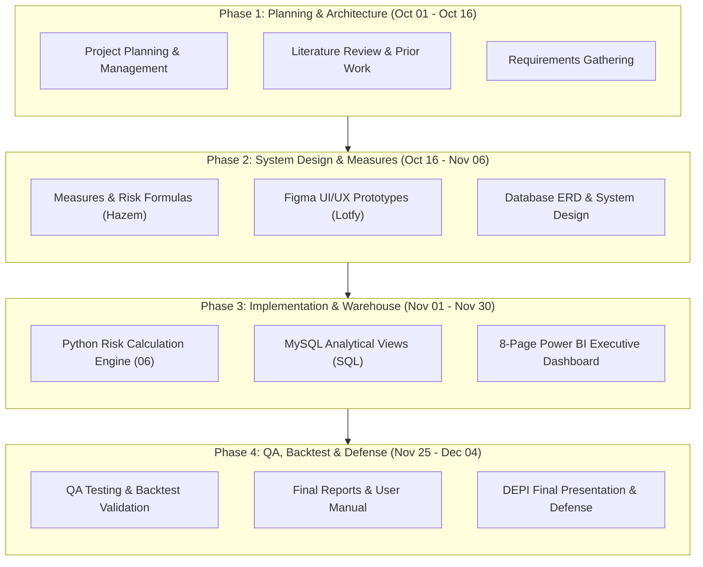

# DEPI Graduation Project — Milestone 1
## 1. Project Planning & Management

**Track:** Professional Data Analyst (DEPI Round 5)  
**Group ID:** BNS5_DAT3_S1  
**Project Name:** Financial Risk Early Warning System (EWS)  
**Team Leader:** Abdalatyf Ahmed Ibrahim  
**GitHub Repository:** [Financial_Risk_EWS](https://github.com/abdalatyf/Financial_Risk_EWS)  
**Submission Date:** October 16, 2026  

---

### 1.1 Project Proposal

#### Project Overview
The **Financial Risk Early Warning System (EWS)** is an enterprise-grade econometric and forensic financial intelligence platform designed to mathematically detect and forecast systemic bank failure vulnerabilities. Using official regulatory data from the Federal Financial Institutions Examination Council (FFIEC Call Reports), Federal Reserve macroeconomic indicators (FRED), and equity market dynamics over a 15-year historical horizon (2008–2022), the project analyzes an econometric panel of **20 commercial banks across 60 quarters (1,200 bank-quarters)**.

#### Problem Statement
The March 2023 collapse of Silicon Valley Bank (SVB), Signature Bank, and First Republic Bank marked the second-largest banking crisis in U.S. history. Traditional regulatory metrics—specifically regulatory Capital Adequacy ratios (CET1 and Tier 1 Capital)—classified these institutions as *"Well Capitalized"* right up to the week of failure. 

Traditional monitoring suffered from three critical blind spots:
1. **The AOCI Opt-Out Accounting Loophole:** Unrealized paper losses on Held-to-Maturity (HTM) and Available-for-Sale (AFS) bond portfolios were excluded from regulatory capital calculations.
2. **Extreme Liability Concentration:** Excessive reliance on uninsured, non-interest-bearing corporate/venture deposits created an unprecedented deposit flight risk.
3. **The Static Ratio Fallacy:** Relying on single-quarter accounting snapshots instead of dynamic time-series velocity (surge rates, loan-sector concentration, and peer-relative z-scores).

#### Project Objectives
1. **Forensic Reconstruction:** Extract, sanitize, and normalize 15 years of Call Reports (60 quarters) into a high-performance Star Schema database.
2. **Risk Measure Architecture:** Engineer 31 specialized risk indicators across 7 core pillars: Capital, Liquidity & Deposits, Funding, Securities & Rate Shock, Loan Portfolio Diversity, Profitability, and Market Signals.
3. **Dual-Sided Vulnerability Proof:** Mathematically prove that SVB's collapse was foreseeable by Q4 2022 using the **Liquidity Fragility Ratio** and **Adjusted Capital Illusion Gap**.
4. **Composite EWS Model & Backtest:** Build a transparent, composite 0–100 Early Warning Index and empirically backtest its lead time and false-positive rate across all 20 banks.
5. **Interactive Executive Intelligence:** Deliver an enterprise-grade Power BI dashboard suite based on dedicated Figma UI/UX prototypes.

#### Project Scope
* **Temporal Horizon:** Q1 2008 through Q4 2022 (Quarterly Financials) + Daily Market/Macro data through 2023.
* **Target Cohort (20 Banks across 4 Tiers):**
  * *Tier 1 (Crisis Casualties - 4):* Silicon Valley Bank (SVB), Signature Bank (SBNY), First Republic Bank (FRC), Silvergate Bank (SI).
  * *Tier 2 (High-Stress Survivors - 5):* Pacific Western (PACW), Western Alliance (WAL), Comerica (CMA), Zions (ZION), New York Community Bank (NYCB).
  * *Tier 3 (Regional Peers - 6):* KeyBank (KEY), Fifth Third (FITB), M&T Bank (MTB), Huntington (HBAN), Citizens (CFG), Regions Financial (RF).
  * *Tier 4 (Mega G-SIBs - 5):* JPMorgan Chase (JPM), Bank of America (BAC), Wells Fargo (WFC), PNC Financial (PNC), U.S. Bancorp (USB).
* **Out of Scope:** Consumer credit scoring, predictive machine learning black-box neural networks (focus is on explainable econometric risk indices and regulatory forensic accounting).

---

### 1.2 Project Plan & Timeline (Gantt & Milestones)

The project adheres strictly to the official DEPI milestone delivery schedule spanning 12 weeks:

#### Official Milestone Checkpoints

| Milestone | Official Deadline | Core Deliverables | Status |
| :--- | :--- | :--- | :--- |
| **Milestone 1** | **16 Oct 2026** | Project Proposal, Plan, Team Roles, Literature Review, Requirements Gathering | **Completed / Submitted** |
| **Milestone 2** | **06 Nov 2026** | System Analysis & Design (ERD, DFD, Architecture, Figma UI/UX, Tech Stack) | **In Progress** |
| **Milestone 3** | **30 Nov 2026** | Implementation (ETL Pipeline, Python Risk Engine, MySQL Loader, Power BI) | **Scheduled** |
| **Milestone 4** | **04 Dec 2026** | QA Test Plan, Backtest Validation, User Manual, Final PPT, Video Demonstration | **Scheduled** |

---

### 1.3 Task Assignment & Team Roles

The project operates under a professional Agile structure dividing responsibilities across Business/Finance Leadership and Technical Engineering:

| Team Member Name | Student ID | Contact Details | Assigned Role & Core Deliverables |
| :--- | :---: | :--- | :--- |
| **Abdalatyf Ahmed Ibrahim** | *[Group Leader]* | `BNS5_DAT3_S1` | **Team Leader, Lead Data Architect & Backend Engineer**   Overall project architecture, GitHub repo ownership, MySQL Star Schema design, Python ETL engine (`01b`–`05`), code reviews, DevOps automation, final technical deliverable compilation. |
| **Hazem Taha Hosny Taha**   *(حازم طه حسني طه)* | **21154651** | `hazemhany114@gmail.com`   `01008035084` | **Financial Lead 1 (Risk & Quantitative Analytics)**   Mathematical formulation of 31 risk metrics, regulatory capital adjustments (AOCI & HTM), warning thresholds (🟢/🟡/🔴), and Composite EWS score weighting. |
| **Mohamed Lotfy Makram Abdelkader**   *(محمد لطفي مكرم عبد القادر)* | **21080880** | `ml9395334@gmail.com`   `01110754480` | **Financial Lead 2 (Strategy, UI/UX & Storyboard)**   Macroeconomic research & crisis chronology, Figma executive design system & wireframes, narrative storyboard, and final defense presentation design. |
| **Mohamed Kamel Farouk Kamel**   *(محمد كامل فاروق كامل)* | **21035035** | `mohamedkamelfarouk22@gmail.com`   `01270144188` | **Lead Power BI Developer (Core Risk Pages 1–4)**   Power BI data model connectivity to MySQL, DAX calculation engine, execution of Core Risk Views (Executive Heatmap, Run Risk Scatter, Rate Shock, Hidden Solvency). |
| **Omar Mohamed Abdulwahab Mohamed**   *(عمر محمد عبد الوهاب محمد)* | **21172370** | `Omarlabib555@gmail.com`   `01212520727` | **QA, Automated Testing & Model Validation Lead**   Automated Python test suites (`tests/test_etl_qa.py`), model backtesting validation, Confusion Matrix & Lead Time auditing, Milestone 4 QA compliance reports. |
| **Ibrahim Mosleh Ibrahim Ahmed**   *(إبراهيم مصلح إبراهيم أحمد)* | **21167200** | `ibrahimmosleh686@gmail.com`   `01207327126` | **Co-Power BI Developer (Portfolio & Deep Dives Pages 5–8 + 9)**   Development of Loan & Liquidity Deep-Dive views, Single-Bank Drill-Down (Page 9), interactive tooltips, cross-filtering bookmarks, and UI component styling from Figma. |

---

### 1.4 Risk Assessment & Mitigation Plan

| Risk Category | Identified Risk | Impact | Probability | Mitigation Strategy |
| :--- | :--- | :--- | :--- | :--- |
| **Data Quality** | Historical missing values (e.g. CET1 pre-2015, FRC pre-2010 charter) | High | High | Enforced structural NULL handling rather than imputing zeros. Explicitly document regulatory timeline shifts (Basel III phase-in). |
| **Data Quality** | MDRM code changes across 15 years | High | Medium | Implemented regex-driven fallback arrays (`['RCFD', 'RCON', 'RCOA']`) in `get_val()` helper. |
| **Methodology** | Hindsight bias in EWS indicator selection | High | Medium | Freeze the 6 composite indicators and weights *a priori* based on published regulatory literature before running the backtest. |
| **Technical** | Power BI latency when querying raw fact tables | Medium | High | Push heavy calculations down to Python and MySQL; expose denormalized, indexed analytical SQL views for Power BI. |
| **DevOps** | Environment inconsistency across team members' laptops | High | Low | Created 1-click `setup_and_run.bat`, automated virtual environment creation, dynamic relative paths, and `.env` template. |
| **Timeline** | Tight turnaround between design and implementation | Medium | Medium | Parallelized workflows: CS developers work on templates while Finance leads finalize formulas and Figma prototypes. |

---

### 1.5 Key Performance Indicators (KPIs)

To evaluate the engineering and analytic success of the project, the team monitors the following KPIs:

#### Engineering & Technical KPIs
* **ETL Pipeline Execution Time:** Complete end-to-end extraction, transformation, and loading of 15 years of data in $< 180$ seconds.
* **Data Integrity & Reconciliation:** Zero reconciliation variance in the loan book identity ($\text{Total Loans} = \sum \text{16 Sectors} - \text{Unearned Income}$).
* **Database Query Response Time:** Analytical view execution time $< 500$ ms in MySQL for Power BI visuals.
* **Code Reliability:** 100% reproducible execution on a fresh machine via `setup_and_run.bat`.

#### Analytical & Early Warning KPIs
* **Lead Warning Time:** The EWS composite score must flag Tier 1 casualties (SVB, SBNY, FRC, SI) as **High Risk / Red** at least **2 quarters prior to Q1 2023** (i.e. by Q2 or Q3 2022).
* **False Positive Rate:** Less than $15\%$ of Tier 3 (Regional Peers) and Tier 4 (Mega Banks) bank-quarters classified as Red during non-crisis quarters.
* **Explanatory Power:** Demonstrating that the **Liquidity Fragility Ratio** $> 1.0$ correctly separates insolvent banks under run scenarios from stable peers.
