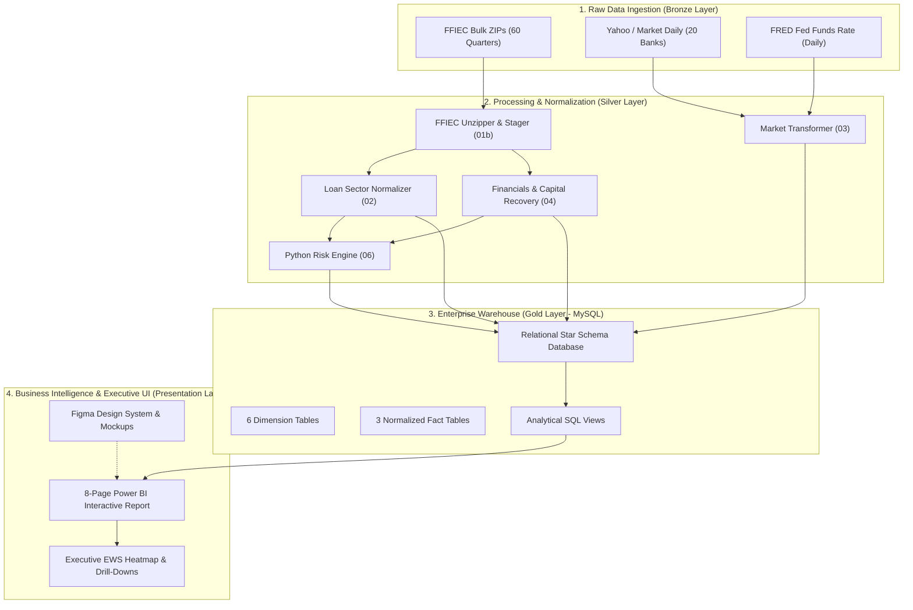
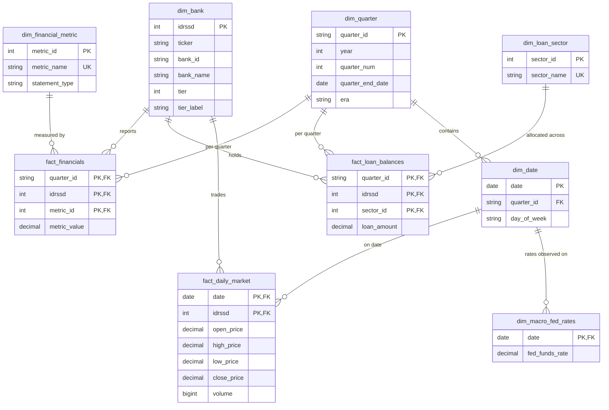
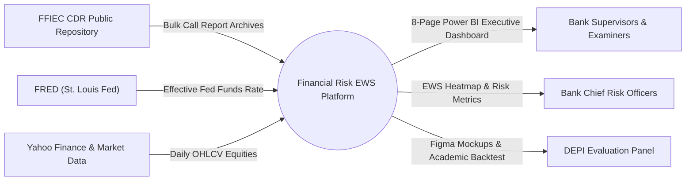
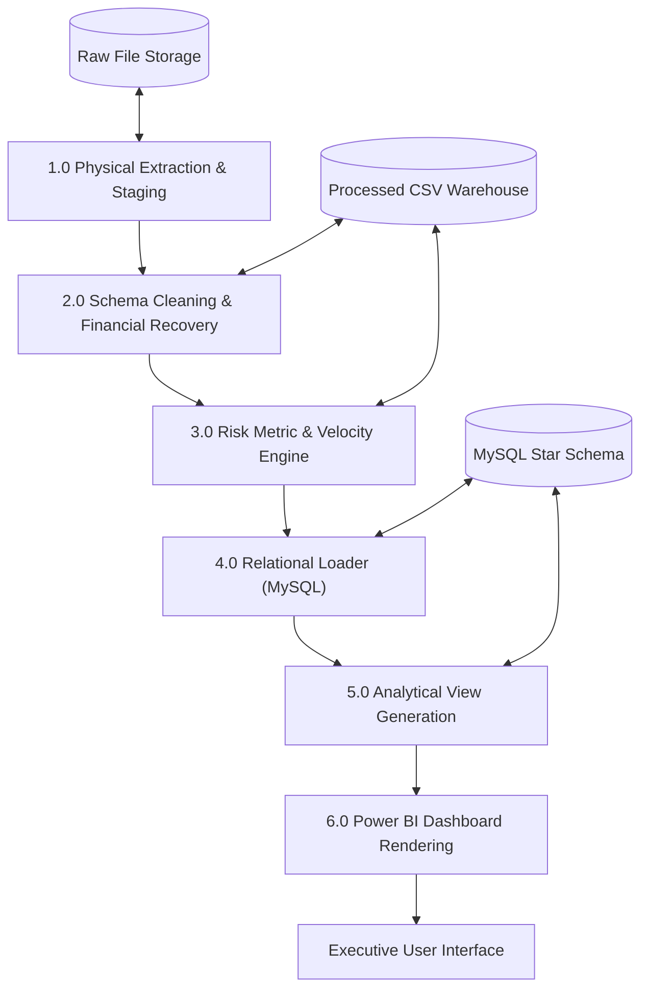
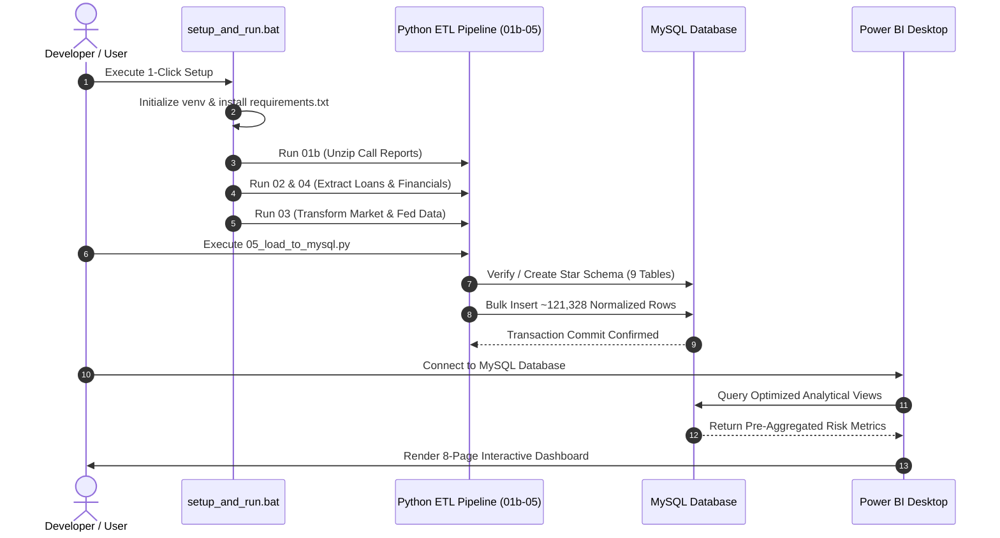

# DEPI Graduation Project — Milestone 2
## 4. System Analysis & Design

**Track:** Professional Data Analyst (DEPI Round 5)  
**Group ID:** BNS5_DAT3_S1  
**Project Name:** Financial Risk Early Warning System (EWS)  
**Team Leader:** Abdalatyf Ahmed Ibrahim  
**Submission Deadline:** November 06, 2026  

---

### 4.1 Software Architecture

The Financial Risk EWS follows a decoupled, three-tier **Push-Down Analytical Architecture**:

---

### 4.2 Database Design & Data Modeling (ERD)

The data warehouse is modeled as a normalized **Star / Snowflake Schema** centered around financial performance, credit distribution, and daily market valuation:

---

### 4.3 Data Flow Diagrams (DFD)

#### Level 0: Context-Level DFD

#### Level 1: Detailed Process Flow

---

### 4.4 Data Flow & System Interactions (Sequence Diagram)

---

### 4.5 System Deployment & Technology Stack

| Architecture Layer | Technology Selection | Version / Standard | Justification |
| :--- | :--- | :--- | :--- |
| **Language Runtime** | **Python** | 3.11+ / 3.12 | Industry standard for data engineering, vectorized math, and FFIEC parsing. |
| **Data Manipulation** | **Pandas & NumPy** | pandas 2.2.3, numpy 2.1.2 | High-performance matrix operations and time-series manipulation. |
| **Relational Database** | **MySQL Community Server** | 8.0+ / 9.0 | ACID compliant, high-speed relational Star Schema storage with foreign keys. |
| **Database Connector** | **mysql-connector-python** | 9.0.0 | Native transactional Python-MySQL pipeline communication. |
| **UI/UX Prototyping** | **Figma** | Cloud Standard | Official DEPI design deliverable; establishes layout guidelines and assets. |
| **Data Visualization** | **Microsoft Power BI** | Desktop (Latest) | Interactive multi-page executive dashboards, slicers, and drill-downs. |
| **DevOps & Automation** | **Windows Batch Scripting** | `setup_and_run.bat` | 1-click environment bootstrap, idempotency, and automated execution. |
| **Version Control** | **Git & GitHub** | GitHub Public Repo | Transparent collaboration, branch protection, and full commit lineage. |
