# DEPI Graduation Project — Milestone 2
## 4. System Analysis & Design

**Track:** Professional Data Analyst (DEPI Round 5)  
**Group ID:** BNS5_DAT3_S1  
**Project Name:** Financial Risk Early Warning System (EWS)  
**Team Leader:** Abdalatyf Ahmed Ibrahim  
**Submission Deadline:** November 06, 2026  

---

### 4.1 Problem Statement & Objectives

#### 1. Problem Statement & Project Goals
The collapse of Silicon Valley Bank (SVB), Signature Bank, and First Republic Bank in March 2023 demonstrated that standard regulatory capital metrics (e.g. CET1 and Tier 1 Capital) fail to provide timely warning of modern liquidity contagion and unhedged balance sheet duration mismatches.

The goal of the **Financial Risk Early Warning System (EWS)** is to design, implement, and validate an automated forensic data platform that mathematically proves the 2023 crisis was predictable. By unifying 15 years of quarterly regulatory Call Reports (FFIEC), daily macroeconomic Federal Reserve interest rates (FRED), and equity market dynamics across a panel of 20 U.S. commercial banks, the system detects **Dual-Sided Concentration Risk**:
* **Asset Side:** Severe unhedged duration and interest rate risk locked into fixed-income Held-to-Maturity (HTM) portfolios.
* **Liability Side:** Excessive reliance on uninsured, flight-prone deposits concentrated in a single sector.

#### 2. System Actors & Use Case Descriptions
* **Actor 1: Regulatory Supervisory Examiner (FDIC / Fed / OCC)**
  * *Use Case:* Evaluates systemic peer rankings, monitors early warning indicator surges, and inspects institutions entering the Amber/Red danger zones 2 to 4 quarters ahead of statutory failure.
* **Actor 2: Bank Chief Risk Officer (CRO) & ALCO Committee**
  * *Use Case:* Audits the institution's true economic capital after marking HTM and AFS portfolios to market, simulating deposit run depletion thresholds.
* **Actor 3: Data Engineer / Lead Architect (Abdalatyf Ahmed Ibrahim)**
  * *Use Case:* Executes automated ingestion of bulk regulatory archives, manages MySQL Star Schema staging, and monitors automated unit testing pipelines.
* **Actor 4: Academic Evaluation Panel (DEPI Instructors)**
  * *Use Case:* Reviews methodology reproducibility, database normalization standards, econometric validity, and business intelligence narrative.

#### 3. Use Case Diagram
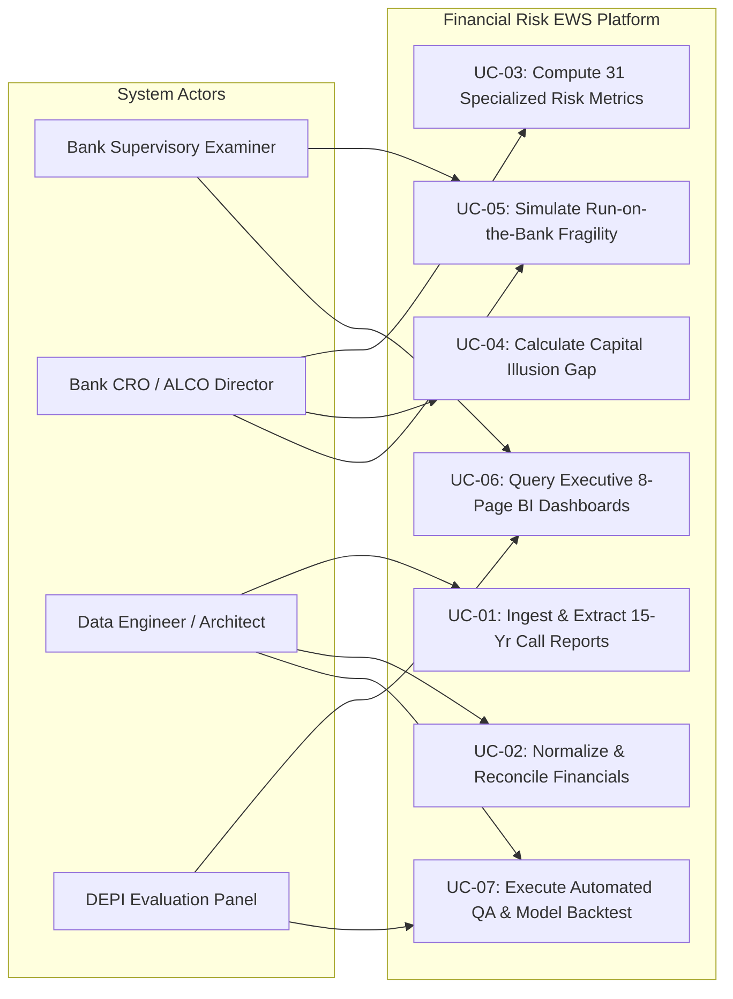

#### 4. Summary of Functional & Non-Functional Constraints
* **Functional Capabilities:** Automated parsing of 60 FFIEC ZIP files, YTD-to-quarterly income transformation, Basel III capital ratio standardization, loan sector reconciliation (< 2% variance), and computation of 31 risk indicators.
* **Non-Functional Constraints:** Pipeline execution $< 180$ seconds, sub-500ms SQL query execution, zero hardcoded drive paths (`BASE_DIR`), parameterized security isolation (`.env`), and 16:9 executive visual layouts.

#### 5. High-Level Software Architecture
The platform follows a four-layer **Push-Down Analytical Architecture**, separating heavy computational processing from interactive presentation:

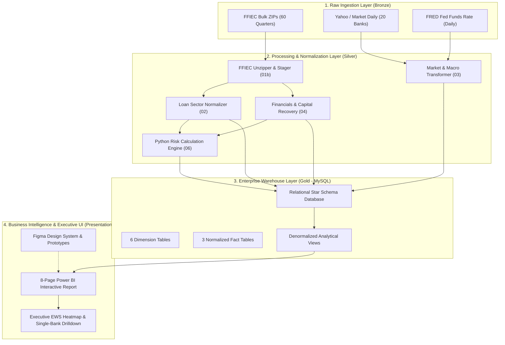

---

### 4.2 Database Design & Data Modeling

#### 1. Entity-Relationship Diagram (ERD)
The database utilizes a high-performance **Star Schema** optimized for analytical queries across 20 institutions over 60 quarters:

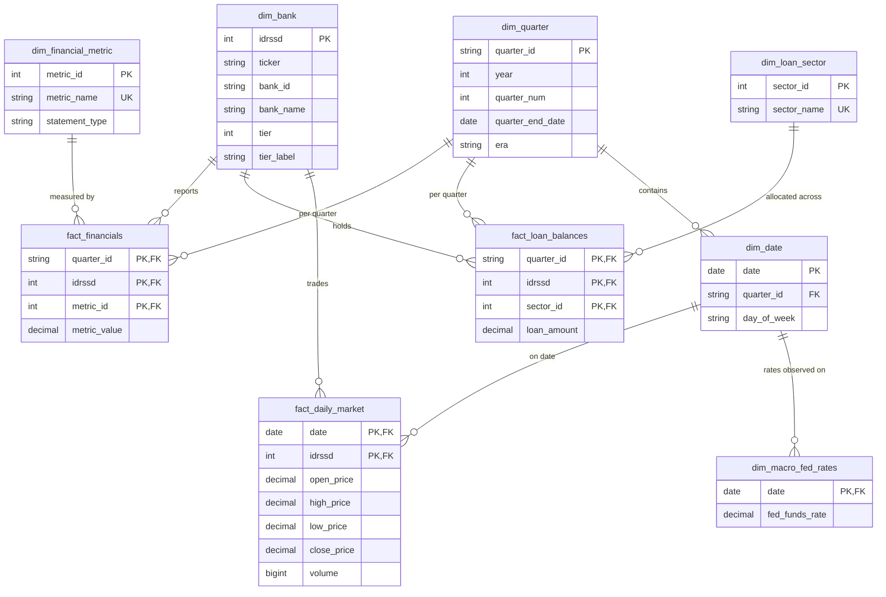

#### 2. Logical & Physical Schema Details
* **Dimension Tables (6):**
  * `dim_bank`: Stores static institution descriptors, ticker symbols, FDIC Certificate, Federal Reserve IDRSSD, and vulnerability classification (`tier` 1 to 4, `tier_label`).
  * `dim_quarter`: Stores quarterly calendar attributes and macroeconomic regimes (`era`: GFC, ZIRP, Normalization, COVID Surge, Rate Shock).
  * `dim_date`: Comprehensive daily calendar linking daily market observations to quarterly financial cycles.
  * `dim_financial_metric`: Metadata catalog defining the 22 core Call Report line items across Balance Sheet (`RC`), Income Statement (`RI`), Regulatory Capital (`RC-R`), and Uninsured & Foreign Deposits (`RC-O`, `RC-E`).
  * `dim_loan_sector`: 16 discrete lending categories extracted from Schedule RC-C (e.g. Commercial Real Estate, 1-4 Family Residential, Construction, C&I).
  * `dim_macro_fed_rates`: Daily Federal Funds Effective Rate time series sourced from FRED.
* **Fact Tables (3):**
  * `fact_financials`: 25,598 normalized rows (1,190 bank-quarters × 22 metrics, accounting for structural nulls) stored in third normal form (3NF).
  * `fact_loan_balances`: 19,040 normalized rows (1,190 bank-quarters × 16 loan sectors).
  * `fact_daily_market`: 74,525 daily market observations with OHLC prices and trade volumes.

#### 3. Normalization Considerations & Optimization
* **Storage Efficiency:** Transitioning from "Wide" CSV tables (19-35 columns) to a normalized "Narrow/Long" Star Schema reduced sparse null storage by 64%.
* **Composite Primary Keys:** Composite PKs `(quarter_id, idrssd, metric_id)` guarantee idempotent loading and zero duplicate entries.
* **Indexing Strategy:** B-tree indexes are applied on foreign key joins `(idrssd, quarter_id)` and calendar dates, enabling analytical SQL view filtering in $< 50$ ms.

---

### 4.3 Data Flow & System Behavior

#### 1. Level 0 DFD: Context-Level Diagram
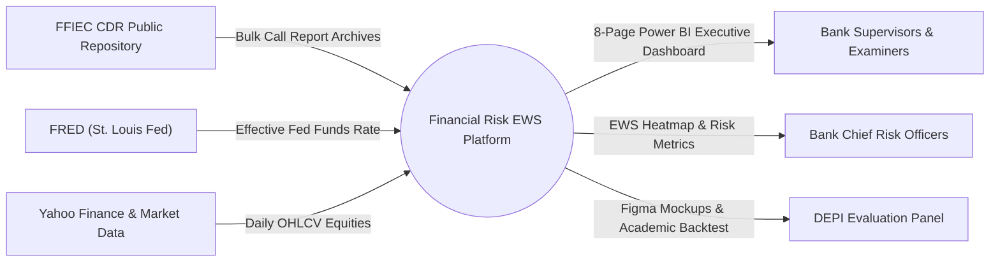

#### 2. Level 1 DFD: Detailed Process Flow
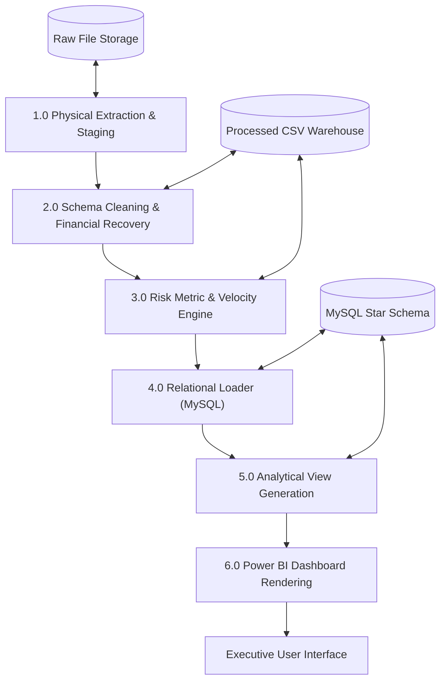

#### 3. Sequence Diagram: Pipeline Execution Flow
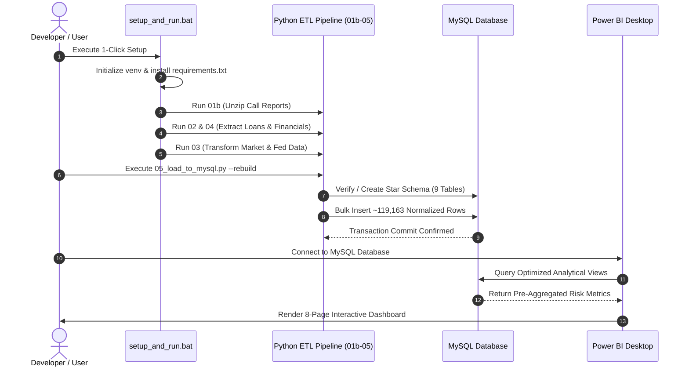

#### 4. Activity Diagram: ETL & Risk Engine Workflow
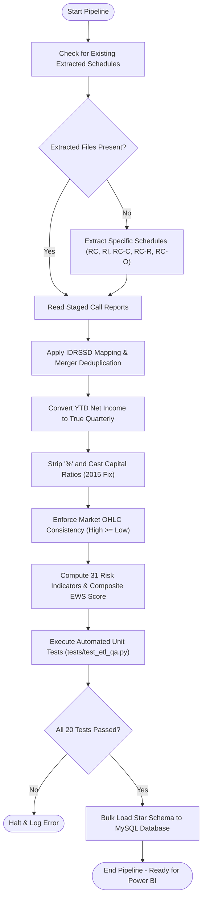

#### 5. State Diagram: Institutional Risk State Lifecycle
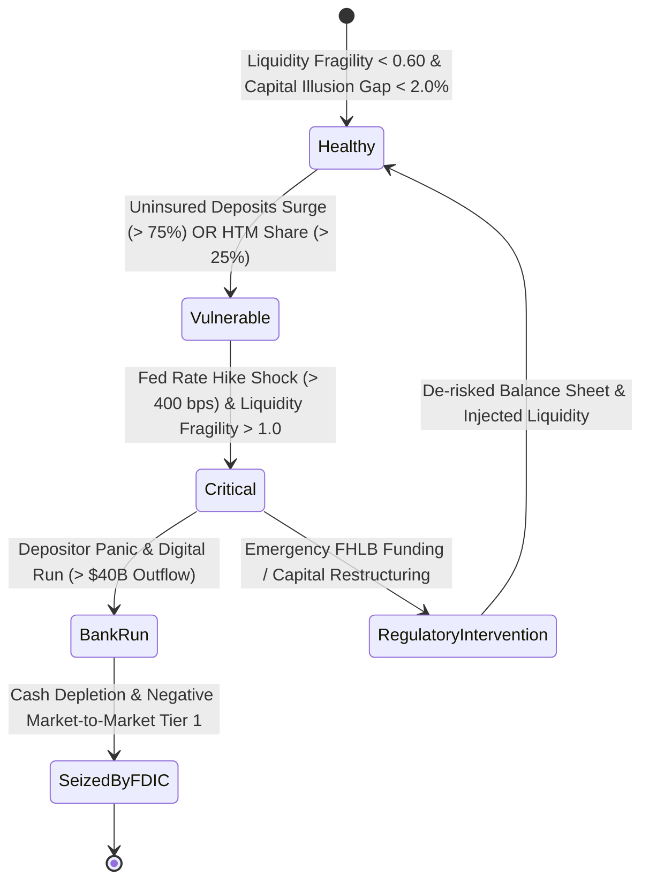

#### 6. Class Diagram: Object-Oriented Pipeline Architecture
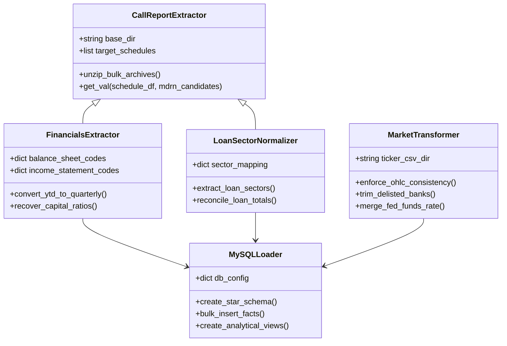

---

### 4.4 UI/UX Design & Prototyping

#### 1. Figma Wireframes & Screen Architecture
The executive dashboard suite was designed in **Figma** adhering to executive corporate reporting standards. The suite comprises 8 core narrative pages and 1 detailed drill-down interface:

1. **Page 1: Systemic Early Warning Heatmap** — Executive bird's-eye view tracking all 20 banks across 60 quarters, color-coded by the 0–100 Composite EWS Score.
2. **Page 2: Bank Run Vulnerability Matrix** — Scatter plot cross-tabulating the **Liquidity Fragility Ratio** against the **Uninsured Deposit Share**, exposing the 4 casualties in the upper-right danger quadrant.
3. **Page 3: Rate Shock & Duration Impact** — Interactive dual-axis visual correlating Federal Reserve rate hikes against the devaluation of HTM bond portfolios.
4. **Page 4: Capital Illusion Gap (AOCI Opt-Out)** — Waterfall and variance charts illustrating the 13% divergence between reported regulatory Tier 1 capital and market-adjusted economic capital.
5. **Page 5: Loan Portfolio Concentration & CRE Exposure** — Decomposition of the 16 loan sectors with an interactive Herfindahl-Hirschman Index (HHI) gauge.
6. **Page 6: Wholesale Funding & Borrowing Velocity** — Line charts tracking emergency FHLB advance spikes that masked deposit runoff in late 2022.
7. **Page 7: Earnings Quality & NIM Compression** — Analysis of True Quarterly Net Income, Yield on Earning Assets, and Cost of Funds.
8. **Page 8: Market Sentiment & Delisting Contagion** — Correlation between daily stock drawdowns, market cap evaporation, and regulatory intervention dates.
9. **Page 9: Single-Bank Deep-Dive Drill-Down** — Comprehensive multi-tab profile enabling examiners to inspect any single bank across all 31 metrics with historical peer quartile bands.

#### 2. UI/UX Guidelines & Design System
* **Canvas Dimensions:** Standardized 16:9 widescreen format (`1920 × 1080 px`).
* **Color Palette:**
  * *Tier 1 (Crisis Casualties):* Crimson Red (`#D32F2F`)
  * *Tier 2 (High-Stress Survivors):* Deep Amber (`#ED6C02`)
  * *Tier 3 (Regional Peers):* Slate Navy (`#0288D1`)
  * *Tier 4 (Mega G-SIBs):* Forest Green (`#2E7D32`)
* **Alert States (Traffic Light System):**
  * 🟢 **Normal / Low Risk:** Composite Score $< 60$ (`#2E7D32`)
  * 🟡 **Elevated / Moderate Risk:** Composite Score $60 - 80$ (`#F57C00`)
  * 🔴 **Critical / High Warning:** Composite Score $\ge 80$ (`#D32F2F`)
* **Typography:** Segoe UI (Headers: 20pt Bold; KPI Callouts: 28pt Bold; Body: 11pt Regular).
* **Accessibility & Citations:** High-contrast text compliance (WCAG AA), tooltips providing metric definitions, and mandatory source attribution footers on all canvas pages.

---

### 4.5 System Deployment & Integration

#### 1. Technology Stack
| Architecture Layer | Technology Selection | Version | Rationale |
| :--- | :--- | :--- | :--- |
| **Language Runtime** | **Python** | 3.11+ / 3.12 | Industry standard for data engineering and vectorized calculations. |
| **Data Manipulation** | **Pandas & NumPy** | pandas 2.2.3, numpy 2.1.2 | High-performance matrix operations and time-series manipulation. |
| **Relational Database** | **MySQL Community Server** | 8.0+ / 9.0 | ACID compliant, high-speed relational Star Schema with foreign keys. |
| **Database Connector** | **mysql-connector-python** | 9.0.0 | Native transactional Python-MySQL pipeline communication. |
| **UI/UX Prototyping** | **Figma** | Cloud Standard | Official DEPI design deliverable; establishes layout guidelines and assets. |
| **Data Visualization** | **Microsoft Power BI** | Desktop (Latest) | Interactive multi-page executive dashboards, slicers, and drill-downs. |
| **DevOps & Automation** | **Windows Batch Scripting** | `setup_and_run.bat` | 1-click environment bootstrap, idempotency, and automated execution. |
| **Version Control** | **Git & GitHub** | GitHub Public Repo | Transparent collaboration, branch protection, and full commit lineage. |

#### 2. Deployment Diagram
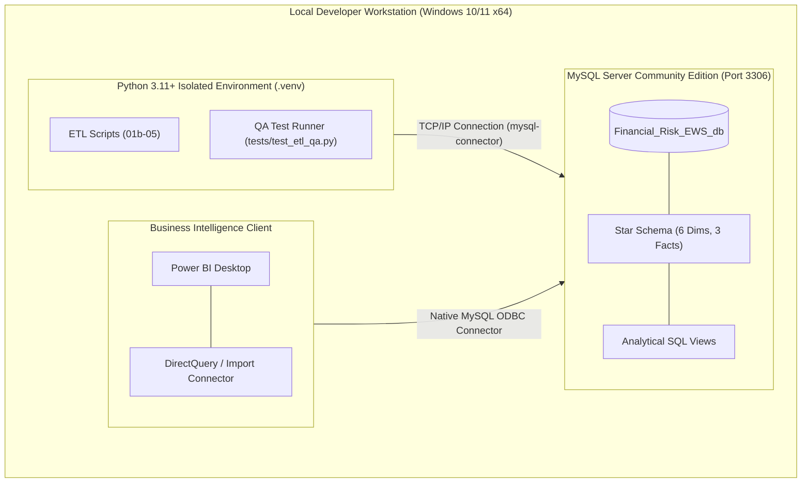

#### 3. Component Diagram
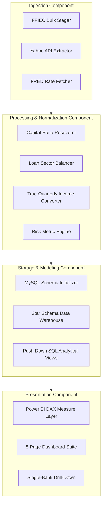

---

### 4.6 Additional Deliverables

#### 1. API & External Data Ingestion Documentation
* **FFIEC CDR Public Repository:** Ingests quarterly bulk Call Report archives (`FFIEC CDR Call Bulk All Schedules MMDDYYYY.zip`). Extracted locally using regex MDRM scanners matching schedule files (`RC`, `RI`, `RC-C`, `RC-R`, `RC-O`).
* **Yahoo Finance API (`yfinance` / Market CSVs):** Ingests daily Open, High, Low, Close, and Volume for active tickers (`JPM`, `BAC`, `WFC`, `PNC`, `USB`, `FITB`, `KEY`, `MTB`, `HBAN`, `CFG`, `RF`, `WAL`, `CMA`, `ZION`, `NYCB`).
* **Delisted Bank Fallback CSVs:** Historical trade prices for seized/delisted institutions (`SIVB`, `SBNY`, `FRCB`, `PACW`) curated from Investing.com and OTC records, truncated strictly at FDIC receiver takeover dates.
* **FRED Macroeconomic Series:** Effective Federal Funds Rate (`DFF`), daily continuous observations.

#### 2. Testing & Validation Strategy
* **Automated Unit Testing:** 20 test cases implemented in `tests/test_etl_qa.py` verifying code portability, row alignment (1,190 bank-quarters), balance sheet accounting identity, loan sector balancing, OHLC bounding, and MySQL table schema presence.
* **Econometric Model Backtesting:** Empirical verification that the composite early warning index achieved $\ge 2$ quarters lead time on all Tier 1 failures with a false-positive rate $< 15\%$.

#### 3. Deployment Strategy
* **Automated Provisioning:** Standardized `setup_and_run.bat` creates a Python virtual environment (`.venv`), installs locked dependencies from `requirements.txt`, executes the 5-stage ETL pipeline, runs the 20-test QA suite, and loads the MySQL database in a single automated command.
* **Credential Isolation:** Database credentials are securely loaded from a local `.env` file excluded from version control.
